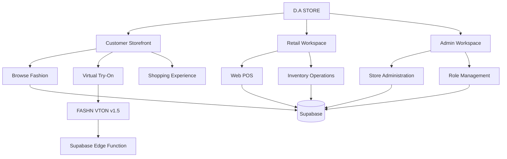
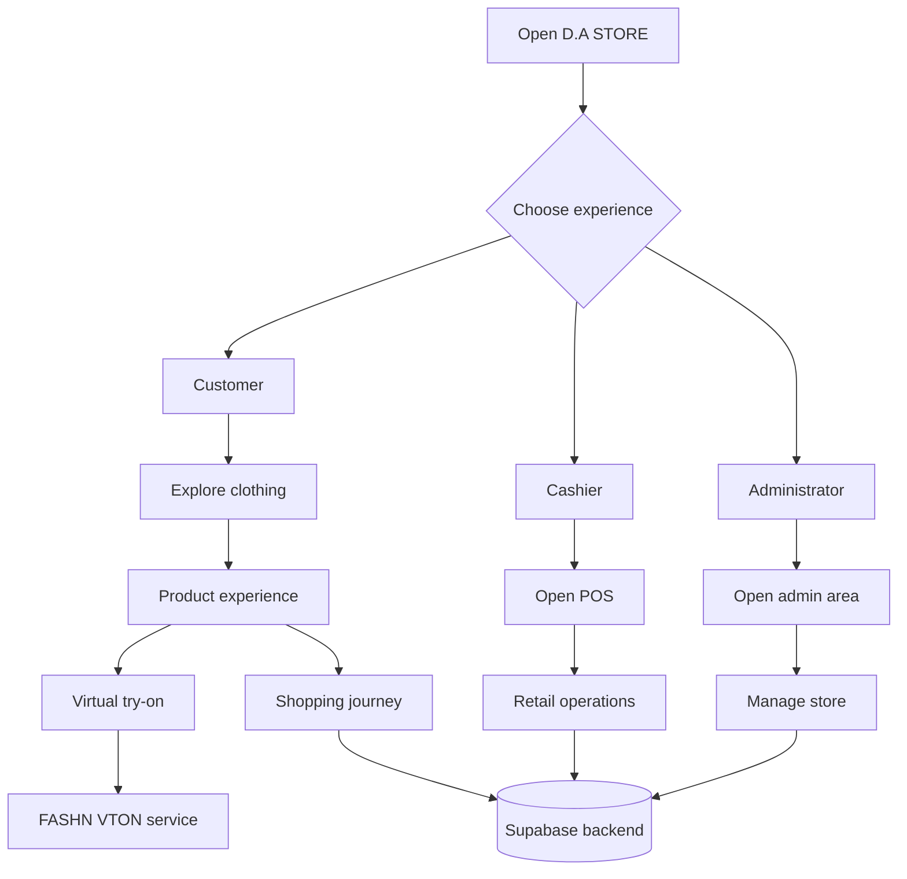

<div align="center">


# D.A STORE
### dastorev2.netlify.app
### THE DIGITAL HOME OF MODERN MENSWEAR

**Discover. Experience. Try on. Shop.**

A modern fashion-commerce experience built to bring the in-store shopping journey online — with a customer storefront, point-of-sale workspace, inventory management, admin tools, and AI-powered virtual try-on.

<br/>

<a href="https://github.com/Zaifi059/D.A-STORE-SOURCE">
  
</a>


<br/><br/>

> **Style is personal. Shopping should be effortless.**  
> D.A STORE combines a polished clothing storefront with practical tools for running a fashion business.

</div>

---

## ✦ A QUICK LOOK

<table>
<tr>
<td width="50%" valign="top">

### 🛍️ Customer experience
Explore a fashion storefront designed around product discovery and a smooth shopping journey.

</td>
<td width="50%" valign="top">

### 🧾 Retail operations
A web-based POS and management workspace bring day-to-day store operations into one place.

</td>
</tr>
<tr>
<td width="50%" valign="top">

### 📦 Inventory
Real-time inventory capabilities help keep product availability aligned with store activity.

</td>
<td width="50%" valign="top">

### 👔 Virtual try-on
FASHN VTON v1.5 integration brings an AI-assisted virtual try-on experience to the platform.

</td>
</tr>
</table>

## ✨ WHAT MAKES IT DIFFERENT?

| Experience | What it brings |
|:--|:--|
| **Fashion storefront** | A dedicated online shopping experience for clothing and fashion |
| **Point of Sale** | A browser-based POS workspace for retail operations |
| **Admin dashboard** | Administrative tools for managing the store |
| **Live inventory** | Real-time inventory functionality powered by the backend |
| **Virtual try-on** | FASHN VTON v1.5 integration through a Supabase Edge Function |
| **Role-aware access** | Customer, cashier, and admin roles |
| **Responsive foundation** | A modern React application styled with Tailwind CSS |

---

## 🧩 THE PLATFORM AT A GLANCE



## 🛠️ TECHNOLOGY STACK

<div align="center">

| FRONTEND | BACKEND & SERVICES | TOOLING |
|:--:|:--:|:--:|
|  |  |  |
|  |  |  |
|  |  |  |

</div>

**Core dependencies**
- React `18.3`
- Vite `5`
- Tailwind CSS `3`
- Supabase JavaScript client `2`
- React Router DOM `6`
- Lucide React icons

---

## 🖼️ VISUAL SHOWCASE

<div align="center">

### THE D.A STORE EXPERIENCE


<br/><br/>

**DISCOVER YOUR STYLE**  
*An integrated fashion storefront and retail management experience.*

</div>

> This README uses lightweight badges and brand-style visual elements instead of empty screenshot placeholders. No extra image files are required.

---

## 🔐 USER ROLES

The application defines three roles:

| Role | Access |
|:--|:--|
| `customer` | Default role for registered customers |
| `cashier` | POS workspace (`/pos`) |
| `admin` | POS workspace and admin area (`/pos` + `/admin`) |

### First admin setup

1. Create an account through the application.
2. Open your project's **Supabase SQL Editor**.
3. Run the following query, replacing the email with the account you want to promote:

```sql
UPDATE public.profiles
SET role = 'admin'
WHERE id = (
  SELECT id
  FROM auth.users
  WHERE email = 'you@example.com'
);
```

**Security note:** Only promote trusted accounts to the administrator role. Keep database credentials and service-role secrets out of frontend code and public commits.

---

## 🚀 GETTING STARTED

### Requirements

Before running the project, make sure you have:

- [Node.js](https://nodejs.org/) installed
- npm (included with Node.js)
- A Supabase project
- The Supabase project URL and anon/public key

### 1. Clone the repository

```bash
git clone https://github.com/Zaifi059/D.A-STORE-SOURCE.git
cd D.A-STORE-SOURCE
```

### 2. Install dependencies

```bash
npm install
```

### 3. Configure environment variables

Create a `.env` file in the project root:

```env
VITE_SUPABASE_URL=your_supabase_project_url
VITE_SUPABASE_ANON_KEY=your_supabase_anon_key
```

You can use the included `.env.example` as your starting point. Replace the example values with your own Supabase project details.

### 4. Start the development server

```bash
npm run dev
```

Open the local URL printed in your terminal by Vite.

### 5. Create a production build

```bash
npm run build
```

To preview the production build locally:

```bash
npm run preview
```

---

## ☁️ DEPLOYMENT — NETLIFY

D.A STORE includes a `netlify.toml` configuration and a `public/_redirects` file for single-page application routing.

1. Push the project to GitHub.
2. Import the repository into [Netlify](https://www.netlify.com/).
3. Configure the build settings:

   | Setting | Value |
   |:--|:--|
   | Build command | `npm run build` |
   | Publish directory | `dist` |

4. Add the environment variables:

```env
VITE_SUPABASE_URL=your_supabase_project_url
VITE_SUPABASE_ANON_KEY=your_supabase_anon_key
```

5. Deploy the site.

> **Important:** Environment variables prefixed with `VITE_` are exposed to the browser bundle. Use only the Supabase anon/publishable key in the frontend, and protect your data with correctly configured Row Level Security (RLS) policies. Never put a Supabase service-role key or FAL secret in a `VITE_` variable.

---

## ⚡ VIRTUAL TRY-ON — FASHN VTON v1.5

The repository includes a Supabase Edge Function at:

```text
supabase/functions/fashn-tryon
```

The function connects the application to the FASHN VTON v1.5 virtual try-on service.

### Deploy the Edge Function

```bash
supabase functions deploy fashn-tryon
```

### Configure the FASHN API secret

```bash
supabase secrets set FAL_KEY=your_fal_key
```

Keep `FAL_KEY` on the server side as a Supabase secret. Do not expose it in the React application or commit it to Git.

---

## 🗂️ PROJECT STRUCTURE

```text
D.A-STORE-SOURCE/
│
├── public/
│   └── _redirects
│
├── src/
│   └── Application source code
│
├── supabase/
│   └── functions/
│       └── fashn-tryon/
│           └── Virtual try-on Edge Function
│
├── .env.example
├── .gitignore
├── index.html
├── netlify.toml
├── package.json
├── postcss.config.js
├── tailwind.config.js
├── vite.config.js
├── LICENSE
└── README.md
```

*The structure above highlights the repository's top-level layout. Explore `src/` for the application modules and components.*

---

## 🧭 APPLICATION FLOW



---

## 🧪 AVAILABLE SCRIPTS

| Command | Description |
|:--|:--|
| `npm install` | Install project dependencies |
| `npm run dev` | Start the Vite development server |
| `npm run build` | Build the application for production |
| `npm run preview` | Preview the production build locally |

---

## 🛡️ SECURITY CHECKLIST

- [ ] Keep `.env` out of version control.
- [ ] Use Supabase RLS policies for protected tables.
- [ ] Keep service-role keys and FASHN/FAL secrets server-side.
- [ ] Restrict administrator role assignment to trusted operators.
- [ ] Validate sensitive operations on the backend.
- [ ] Review Supabase Storage permissions and access policies before production use.

---

## 🗺️ ROADMAP

Ideas for future improvements — not a claim that these features are already implemented:

- [ ] Add polished product and collection screenshots to the documentation.
- [ ] Expand product discovery with advanced filters and sorting.
- [ ] Add customer order-history and order-tracking views.
- [ ] Improve reporting and sales analytics.
- [ ] Add more storefront performance and accessibility checks.
- [ ] Expand automated tests for key shopping and POS workflows.

---

## 🤝 CONTRIBUTING

Contributions, ideas, and feedback are welcome.

1. Fork the repository.
2. Create a feature branch:

   ```bash
   git checkout -b feature/your-feature
   ```

3. Make your changes.
4. Run the production build:

   ```bash
   npm run build
   ```

5. Commit your work:

   ```bash
   git commit -m "feat: describe your update"
   ```

6. Push your branch and open a Pull Request.

Please avoid committing credentials, private customer data, or generated files that do not belong in the source repository.

---

## 📄 LICENSE

This project is distributed under the **MIT License**. See the [`LICENSE`](LICENSE) file for the full license text.

---

## 💬 CONNECT

<div align="center">

### D.A STORE
**Fashion meets technology.**

[](https://github.com/Zaifi059)
[](https://github.com/Zaifi059/D.A-STORE-SOURCE)

<br/>

**Built with purpose. Designed for the modern fashion experience.**

<sub>© D.A STORE — Clothing & Fashion</sub>

</div>
